<p align="center">
  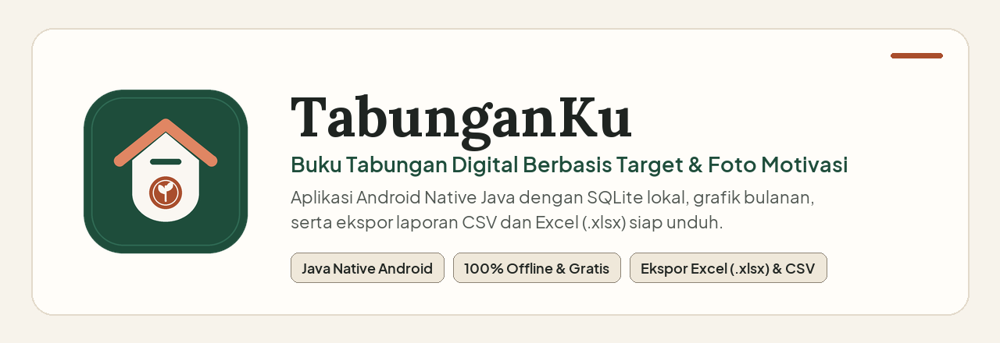
</p>

<h1 align="center">TabunganKu</h1>

<p align="center">
  Aplikasi buku tabungan Android berbasis target dengan foto motivasi, analitik progres menabung, serta ekspor laporan terformat ke Excel (.xlsx) dan CSV.
  <br>
  <strong>100% Gratis · Offline Penuh · Tanpa Iklan · Open-Source Non-Komersial</strong>
</p>

<p align="center">
  <a href="https://github.com/hairift/TabunganKu/releases">Unduh APK Rilis</a> ·
  <a href="docs/PANDUAN-PENGGUNA.md">Panduan Pengguna</a> ·
  <a href="docs/ARSITEKTUR.md">Arsitektur Teknis</a> ·
  <a href="DESIGN.md">Sistem Desain</a> ·
  <a href="LICENSE">Lisensi</a>
</p>

---

## Ringkasan Aplikasi

**TabunganKu** membantu pengguna merencanakan dan mencapai berbagai tujuan keuangan, mulai dari DP rumah, pembelian kendaraan, dana darurat keluarga, pendidikan, hingga barang impian. Setiap target dapat dilengkapi **foto motivasi** agar tujuan menabung terasa lebih nyata dan personal setiap kali membuka aplikasi.

Seluruh data tersimpan secara lokal di perangkat memakai basis data **SQLite (AndroidX Room)** tanpa perlu akun, server eksternal, maupun koneksi internet. Kapan saja dibutuhkan, pengguna dapat mengunduh rekapitulasi laporan yang rapi dalam format **Excel (.xlsx)** dengan rumus otomatis atau **CSV (.csv)**, serta membuat arsip cadangan **ZIP** lengkap beserta foto motivasinya.

---

## Fitur Utama

| Fitur | Keterangan |
| :--- | :--- |
| **Target Tabungan + Foto Motivasi** | Buat banyak target menabung dengan kategori, batas nominal, tanggal sasaran opsional, catatan penyemangat, serta foto impian dari galeri (tersimpan privat + koreksi rotasi EXIF). |
| **Catat Setor dan Tarik Cepat** | Tombol setor cepat dengan chip nominal praktis (`+Rp 50rb` hingga `+Rp 1jt`), format pemisah ribuan otomatis, serta validasi saldo agar penarikan tidak melebihi dana tersedia. |
| **Rekomendasi Setoran Rutin** | Menghitung kebutuhan nabung per hari, minggu, atau bulan secara otomatis apabila pengguna menentukan batas tanggal target. |
| **Grafik Laporan Interaktif** | Grafik batang tren setoran 6 bulan terakhir dan grafik donat sebaran dana terkumpul di setiap target, lengkap dengan penyaring rentang waktu. |
| **Ekspor Excel (.xlsx) dan CSV (.csv)** | Menghasilkan berkas Excel 2 lembar (*Ringkasan Target* dan *Riwayat Transaksi*) berdesain rapi, *freeze header*, format angka Rupiah, dan rumus asli (`=SUM`, `=SUMIF`). |
| **Tema Kertas Hangat & Hutan Malam** | Mendukung tema terang hangat, mode gelap **Hutan Malam**, maupun mengikuti sistem perangkat sesuai standar kontras aksesibilitas WCAG AA. |
| **Pengingat Lokal & Cadangan ZIP** | Pengingat harian lokal pukul 20.00 dan fitur ekspor/pulihkan data JSON + foto target ke satu berkas `.zip`. |

---

## Identitas Visual dan Logo

<p align="center">
  
</p>

Logo **TabunganKu** memadukan siluet celengan bergaya atap rumah yang hangat dengan aksen koin berwarna terakota di atas latar hijau pinus tua (`#1E4D3B`). Pendekatan warna manusiawi (*Kertas Hangat* `#F7F3EB` dan *Hutan Malam* `#141816`) dipilih untuk memberikan pengalaman membaca yang tenang dan nyaman, menjauhi efek neon yang melelahkan mata. Rincian palet dan kontras terdokumentasi di [DESIGN.md](DESIGN.md).

---

## Tangkapan Layar Aplikasi

### 1. Layar Beranda dan Pengelolaan Target

| Beranda Kosong | Tambah Target + Foto Motivasi | Daftar Target Beranda |
| :---: | :---: | :---: |
| 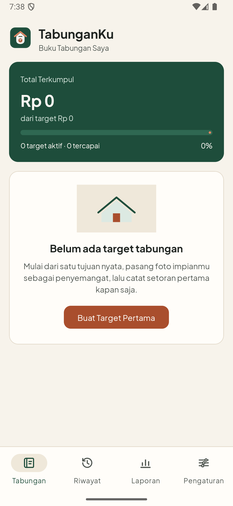 | 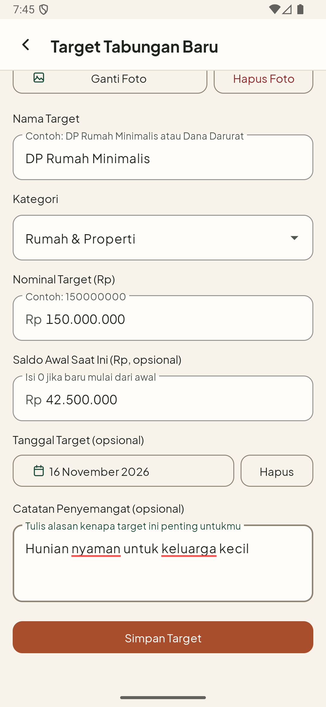 | 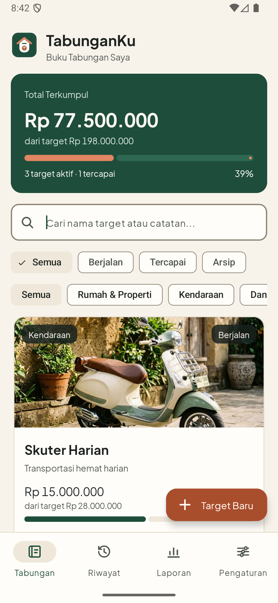 |

### 2. Detail Target, Transaksi, dan Pencapaian

| Detail Target & Rekomendasi | Lembar Catat Setoran Cepat | Notifikasi Target Tercapai |
| :---: | :---: | :---: |
| 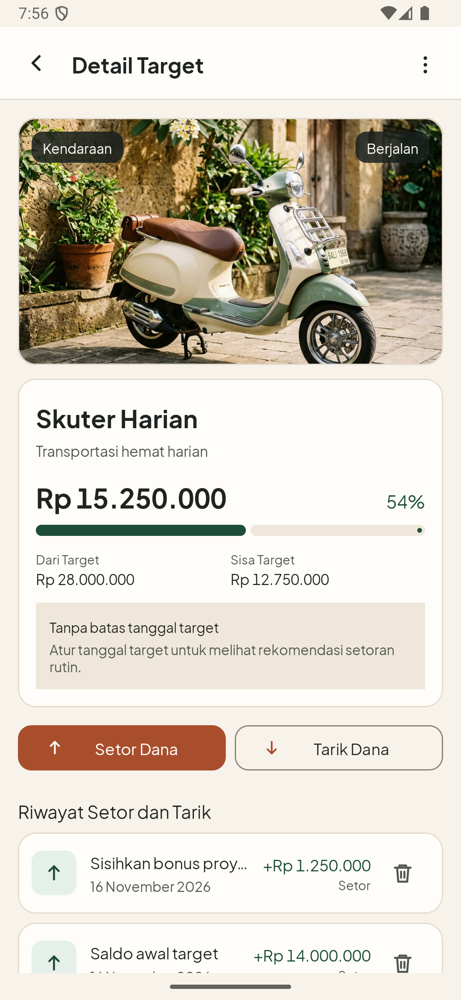 | 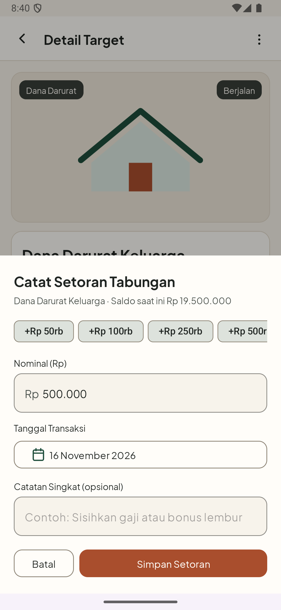 | 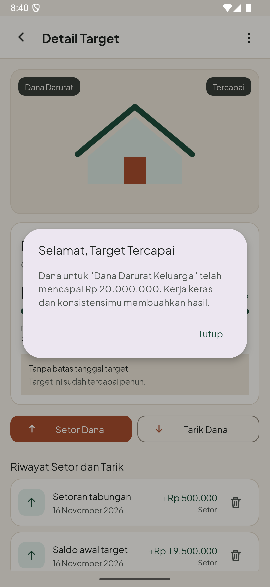 |

### 3. Riwayat Mutasi, Grafik Laporan, dan Pengaturan

| Tab Riwayat Mutasi | Grafik Laporan Bulanan | Grafik Sebaran & Ekspor | Dialog Unduh Berkas |
| :---: | :---: | :---: | :---: |
| 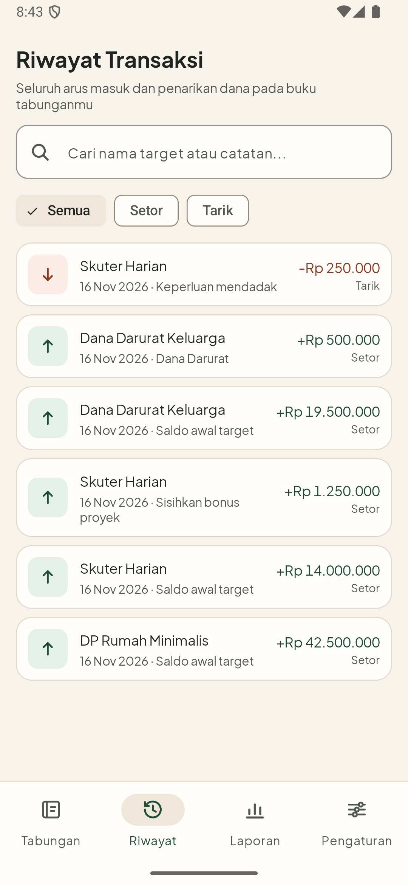 | 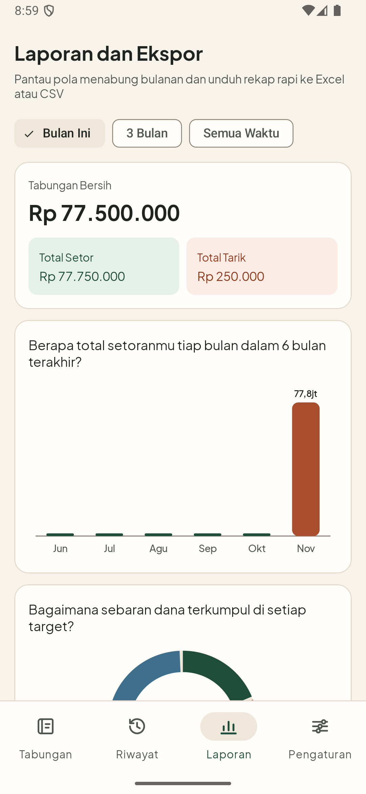 | 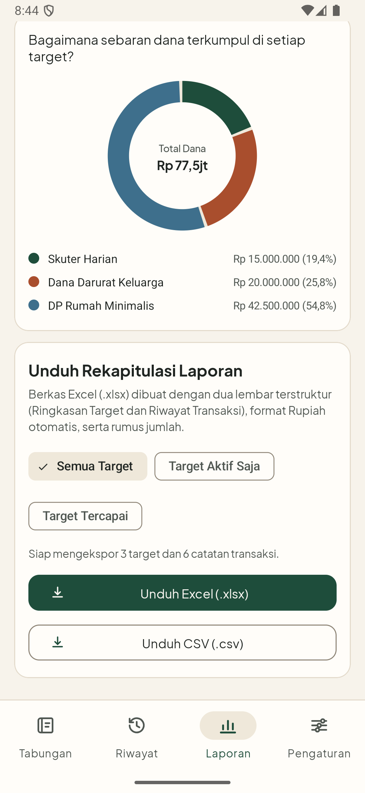 | 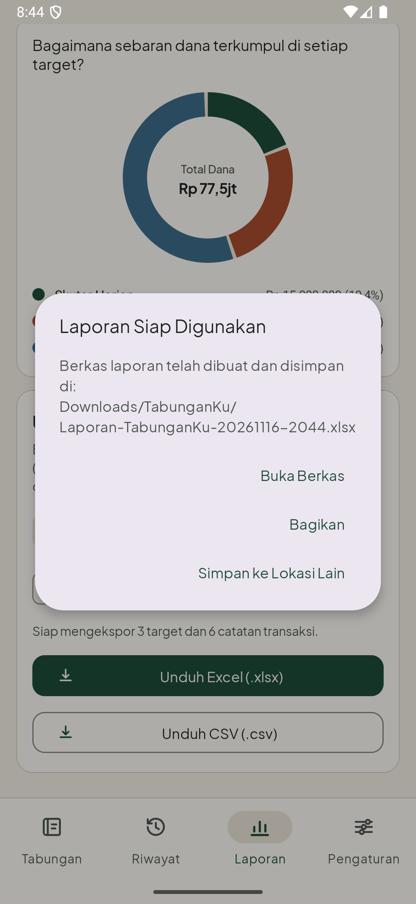 |

### 4. Pengaturan dan Mode Gelap (*Hutan Malam*)

| Tab Pengaturan | Beranda Mode Gelap | Laporan Mode Gelap |
| :---: | :---: | :---: |
| 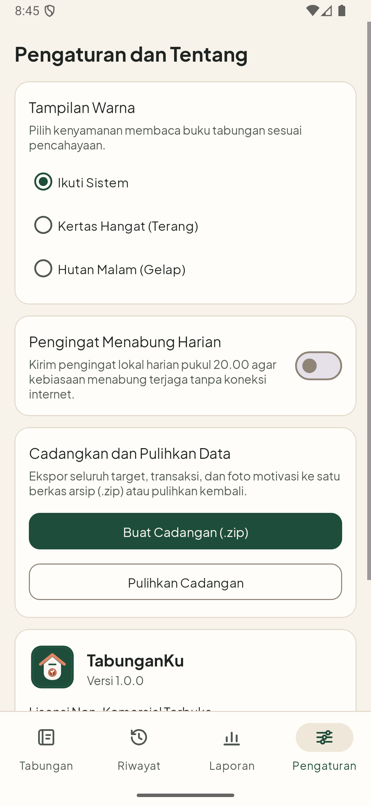 | 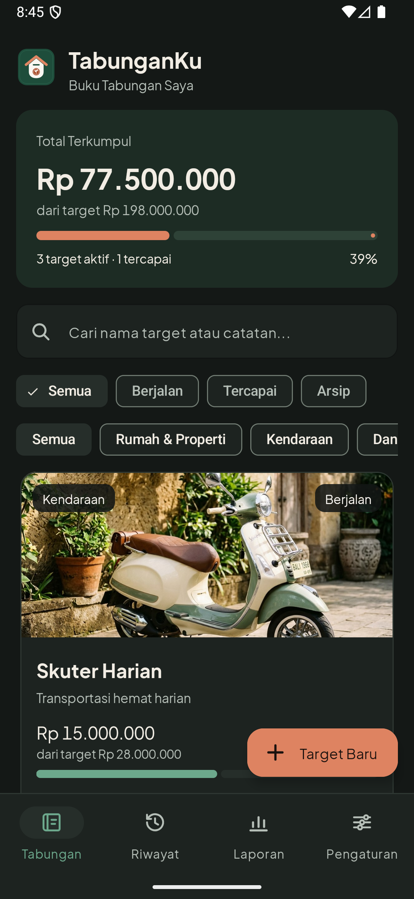 | 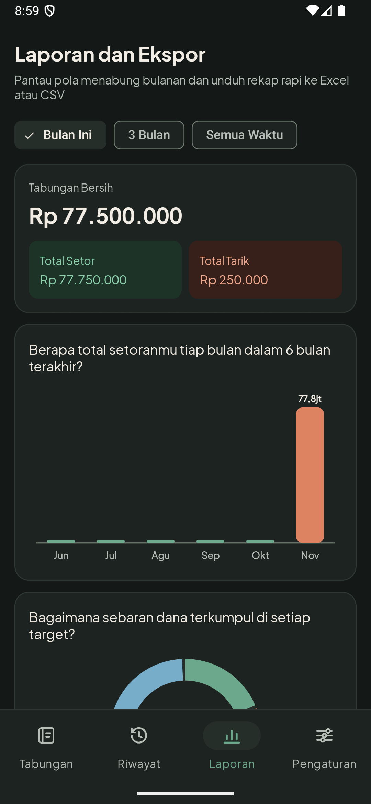 |

### 5. Hasil Ekspor Berkas Excel (.xlsx) Nyata

Berkas `.xlsx` yang dihasilkan langsung dari aplikasi di emulator memiliki tata letak rapi dua lembar (*Ringkasan Target* dan *Riwayat Transaksi*), header terkunci, kartu ringkasan KPI, pewarnaan status, format Rupiah otomatis, serta rumus `=SUM(...)` dan `=SUMIF(...)`:

<p align="center">
  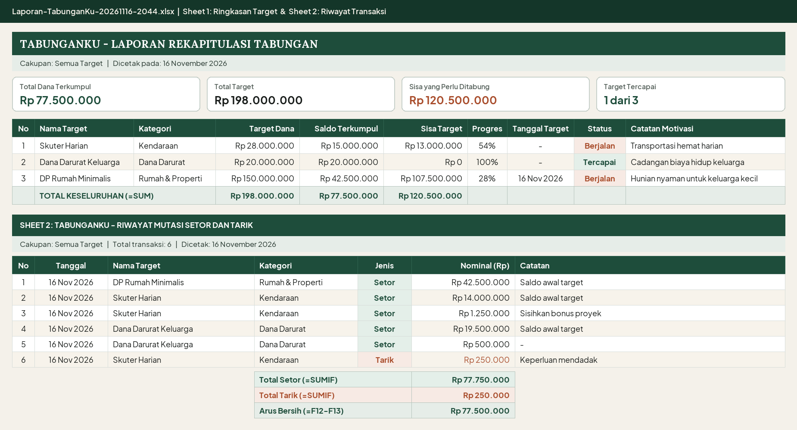
</p>

---

## Tumpukan Teknologi

- **Bahasa Pemrograman:** Java 17 native Android (`minSdk 26` / Android 8.0, `targetSdk 35` / Android 15)
- **Antarmuka:** Android Views, ViewBinding, Material Components 3 (`1.12.0`), Custom `Canvas` Charts (`GrafikBatangBulananView` & `GrafikDonutTargetView`)
- **Basis Data Lokal:** SQLite melalui AndroidX Room (`2.6.1`) dengan transaksi atomik (`runInTransaction`)
- **Generator Ekspor:** Pembangun OOXML `.xlsx` murni Java (`ZipOutputStream`) dan generator CSV RFC 4180 ber-BOM UTF-8 dengan perlindungan injeksi rumus spreadsheet
- **Build System:** Gradle `8.14` dan Android Gradle Plugin `8.11.1` (R8/ProGuard aktif pada build rilis; ukuran APK rilis `2,29 MB`)

---

## Cara Membangun dan Menguji Proyek

### Prasyarat
- JDK 17 (atau JDK 21)
- Android SDK Platform 35 dan Build Tools terpasang

### Menjalankan Unit Test dan Membuat APK
```bash
# 1. Klon repositori
git clone https://github.com/hairift/TabunganKu.git
cd TabunganKu

# 2. Jalankan seluruh unit test (FormatMataUangTest, KalkulatorTargetTest, PembuatCsvTest, PembuatExcelXlsxTest)
./gradlew testDebugUnitTest

# 3. Bangun APK debug untuk pengujian langsung
./gradlew assembleDebug
```

Pada sistem operasi Windows, ganti `./gradlew` dengan `.\gradlew.bat`.

---

## Dokumentasi Lengkap

- **[Panduan Pengguna (PANDUAN-PENGGUNA.md)](docs/PANDUAN-PENGGUNA.md):** Langkah lengkap membuat target, menambah foto motivasi, mencatat mutasi, mengekspor laporan, dan pencadangan data.
- **[Arsitektur Teknis (ARSITEKTUR.md)](docs/ARSITEKTUR.md):** Peta paket kode berbahasa Indonesia, strategi transaksi atomik Room, dan struktur OOXML Excel.
- **[Sistem Desain (DESIGN.md)](DESIGN.md):** Palet warna terang/gelap teruji WCAG AA, skala tipografi (*Lora* & *Plus Jakarta Sans*), aturan kartu, dan prinsip antislop.
- **[Panduan Kontribusi (CONTRIBUTING.md)](CONTRIBUTING.md):** Konvensi kode bersih (*Clean Code*), standar penamaan Bahasa Indonesia, dan aturan kontribusi.

---

## Lisensi

Proyek ini dirilis di bawah **Lisensi Non-Komersial Terbuka TabunganKu (Berbasis PolyForm Noncommercial License 1.0.0)**.

Siapa pun **diizinkan** mengunduh, menggunakan, mempelajari, memodifikasi, dan membagikan ulang aplikasi maupun kode sumber ini secara gratis untuk kebutuhan pribadi, pendidikan, atau kegiatan sosial. Segala bentuk **penjualan, penyewaan, penyisipan iklan, atau pemanfaatan komersial dilarang keras** tanpa izin tertulis pemegang hak cipta. Lihat teks lengkap di berkas [LICENSE](LICENSE).
